<div align="center">


<h1>ReportPilot</h1>

<h3>The monthly client report, written before you start work.</h3>

<p>
  <b>ReportPilot turns Search Console, page speed and uptime into a branded PDF every client can read.</b><br />
  It collects the data, does the maths, writes a plain-English summary and drafts the report on the 3rd,<br />
  then waits for an account manager to read it, add a line and approve. Free to run, no keys for the demo.
</p>

<p>
  <a href="docs/vercel-deployment.md"><b>Deploy to Vercel&nbsp;&rarr;</b></a>
  &nbsp;&nbsp;·&nbsp;&nbsp;
  <a href="TECHNICAL_README.md"><b>Technical Documentation</b></a>
  &nbsp;&nbsp;·&nbsp;&nbsp;
  <a href="#quickstart">Quickstart</a>
  &nbsp;&nbsp;·&nbsp;&nbsp;
  <a href="#inside-the-app">Screenshots</a>
  &nbsp;&nbsp;·&nbsp;&nbsp;
  <a href="#what-you-can-do">Features</a>
  &nbsp;&nbsp;·&nbsp;&nbsp;
  <a href="#built-with">Built with</a>
</p>

</div>

<br />

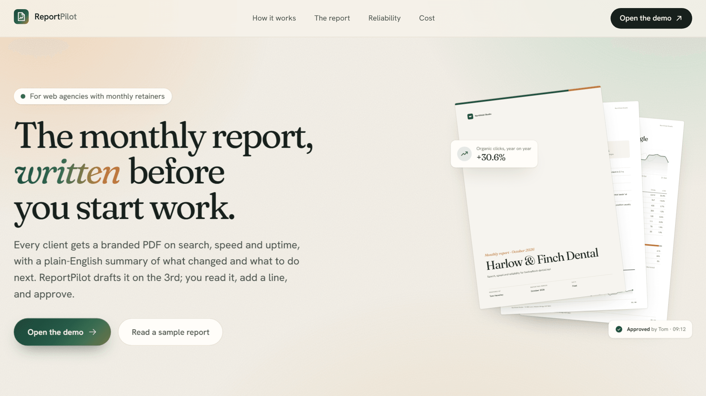

---

## The problem it solves

Agencies on monthly retainers spend **two to four hours per client, every
month,** on reporting. Export Search Console. Run PageSpeed. Check uptime.
Paste screenshots into slides. Write the commentary. Email it. Then do it again
for the next client. With twenty clients that is 40 to 80 hours a month, the
figures drift depending on who pulled them, and problems surface weeks after
they happen.

ReportPilot does that work overnight. On the 3rd of each month, once Google
has finalised the previous month, it collects every client's data, calculates
what changed, ranks what matters, writes a summary in plain English and renders
an eight-page PDF in the agency's own brand. **The account manager reads the
draft, adds a note and approves it in about ten minutes.** Nothing reaches a
client until someone says so.

**Who it is for**

- Web agencies and freelancers who send monthly SEO or website-care reports
  and are tired of rebuilding them by hand
- Account managers who want a draft they can trust, with the opportunities
  already found
- Business owners on the receiving end, who want to know what changed and what
  happens next, not another dashboard login

**What makes it different**

| | |
| --- | --- |
| **Approval before anything is sent** | Draft, in review, approved, sent. Every change is versioned and written to an audit log. Auto-send is a per-client choice, never the default. |
| **Figures you can stand behind** | Every number comes from one tested calculation library, calculated the same way every month. Missing data is shown as missing, never as zero. |
| **AI that cannot misquote a client** | AI may polish the summary, but if its text contains a single figure that is not in the source data, it is thrown away and the template is used. |
| **Opportunities, not just charts** | Keywords one push from page one, pages that are seen but rarely clicked, and how many clicks fixing them is worth. |
| **Free to run** | Cloudflare for uptime, GitHub Actions for the monthly job, Postgres on a free tier and Vercel for the dashboard. About fifty sites before anything costs money. |

---

## Quickstart

**Requirements:** Node.js 22 or newer. No database, accounts or API keys for the demo.

```bash
git clone https://github.com/zain-ul-abideen-5036/ReportPilot.git
cd ReportPilot
npm install
npx playwright install chromium   # for PDF downloads

npm run dev                        # http://localhost:3000
```

**Open the demo** signs you in as the account manager of a fictional agency,
Northfold Studio (the sign-in page also offers the owner and a read-only
viewer). Its eight clients each have a story to tell: a dental practice growing steadily, an outdoor shop
hit by an algorithm update, a vet whose SSL certificate expires in five days, a
heating engineer whose new chat widget slowed the site down.

Everything you change in the demo (notes, approvals, alerts, branding, new
clients) is saved for you, in your browser, and the emails you send are
captured on a **Sent emails** page instead of going out.

To run the real monthly pipeline end to end and get eight PDFs in `output/`:

```bash
npm run demo
```

To try the database mode with email sign-in, without installing Postgres, run
the [local database](TECHNICAL_README.md#trying-the-database-mode-locally).

To put it online, follow the [Vercel guide](docs/vercel-deployment.md): import
the repository, set the root directory to `apps/web`, deploy. To connect real
data, see [deployment](docs/deployment.md) and
[connecting Search Console](docs/search-console-setup.md).

---

## Inside the app

Real captures from the running application with the demo agency. Every figure
is one the app calculated.

### The overview: where the month stands

The October cycle as one bar, from collecting to sent, the reports and alerts
waiting on you, and the time the month saved.

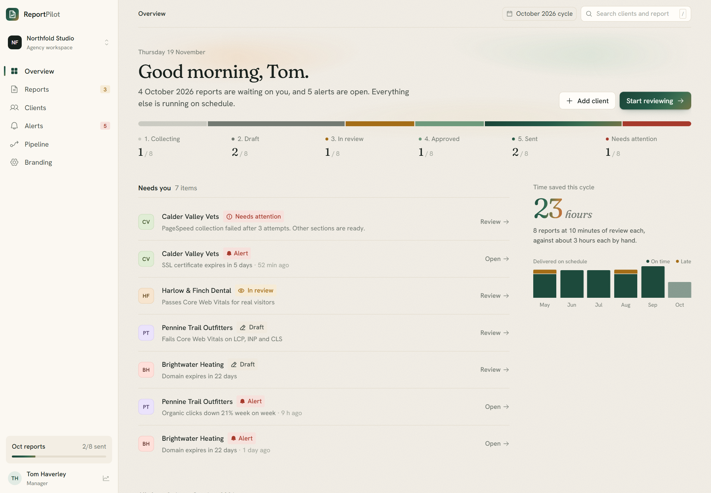

### Review a report, then approve it

The real PDF on the left, scaled to fit. On the right: the approval workflow,
what the report says, your note to the client, auto-send and the Approve button.


### A PDF made for the client, not printed from a dashboard

Eight A4 pages, rendered by a real Chromium from the same components as the
preview, in the agency's colours.

<table>
<tr>
<td width="25%">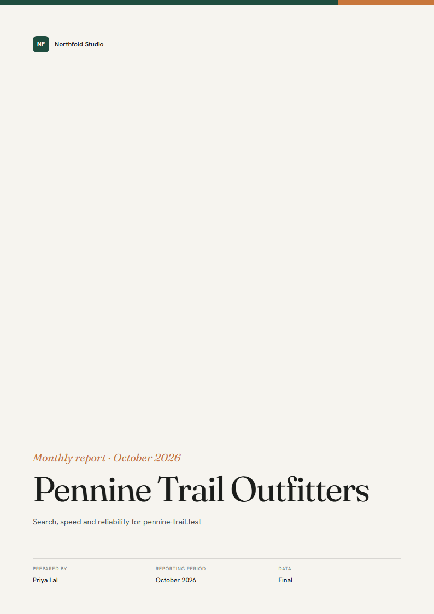</td>
<td width="25%">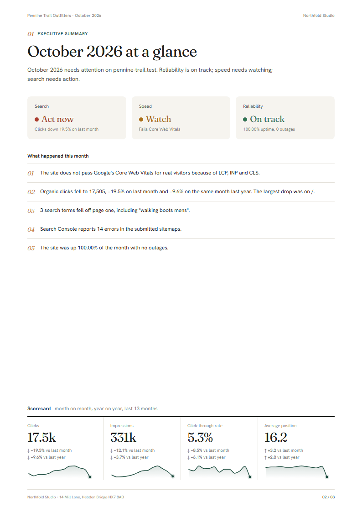</td>
<td width="25%">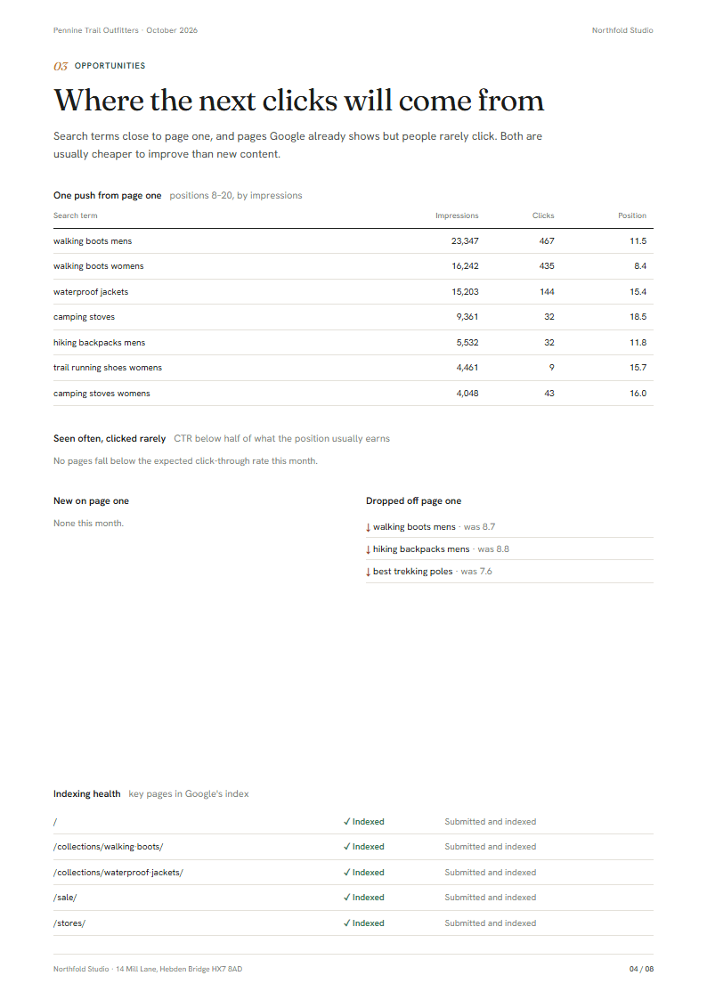</td>
<td width="25%">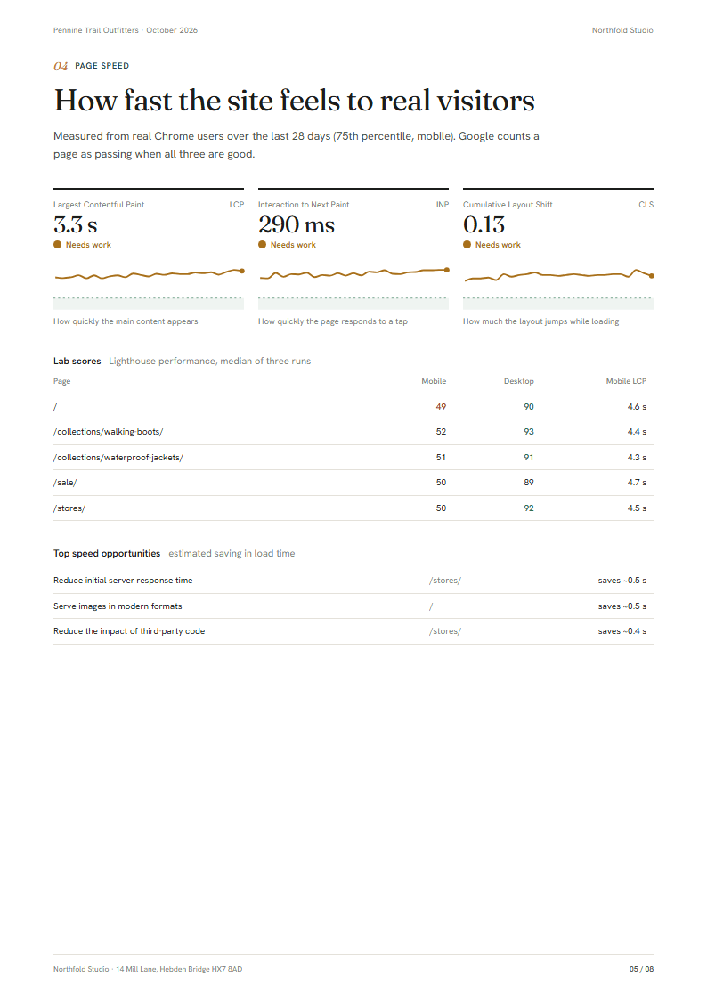</td>
</tr>
<tr>
<td align="center"><b>Cover</b></td>
<td align="center"><b>Summary</b>: status lights, highlights, scorecard</td>
<td align="center"><b>Opportunities</b>: where the next clicks come from</td>
<td align="center"><b>Speed</b>: what real visitors experience</td>
</tr>
</table>

### Clients, branding and the pipeline

<table>
<tr>
<td width="50%"></td>
<td width="50%"></td>
</tr>
<tr>
<td align="center"><b>Client</b>: thirteen months of search, speed and uptime</td>
<td align="center"><b>Branding</b>: pick a palette and watch the report re-theme</td>
</tr>
<tr>
<td width="50%">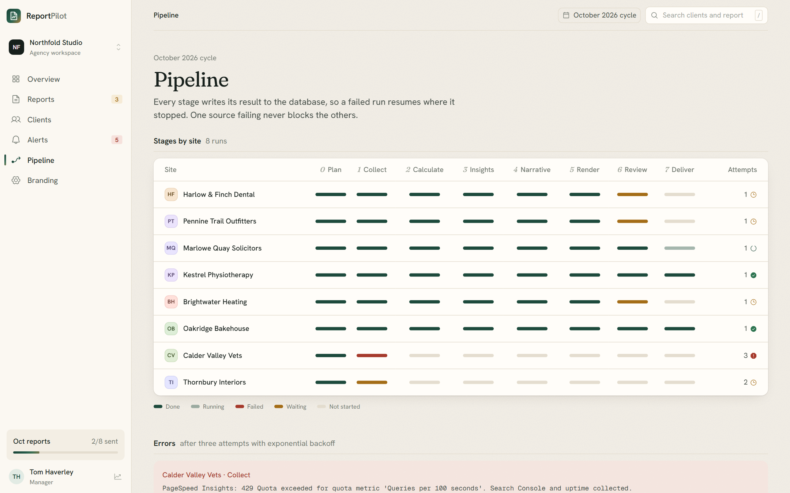</td>
<td width="50%">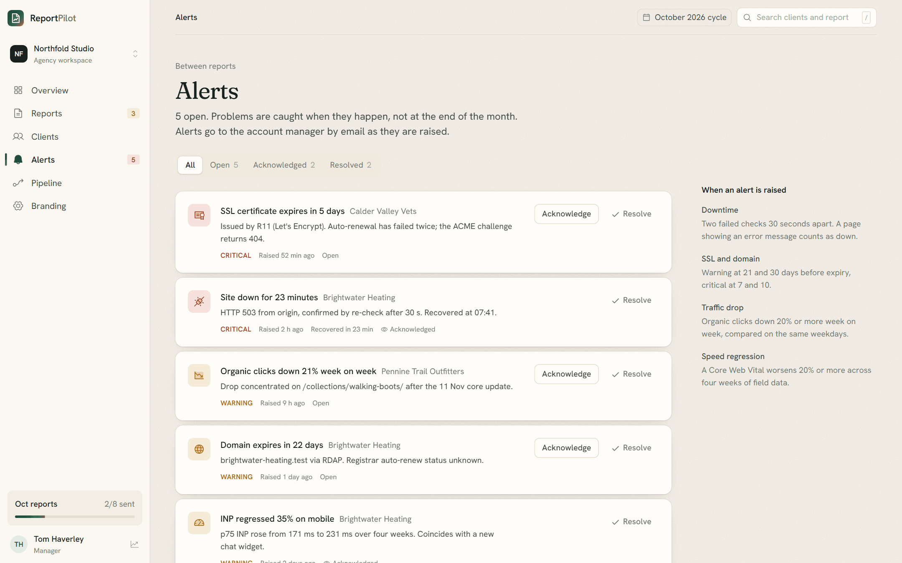</td>
</tr>
<tr>
<td align="center"><b>Pipeline</b>: every stage of every run, and what failed</td>
<td align="center"><b>Alerts</b>: problems caught when they happen</td>
</tr>
</table>

### Adding a client takes five minutes

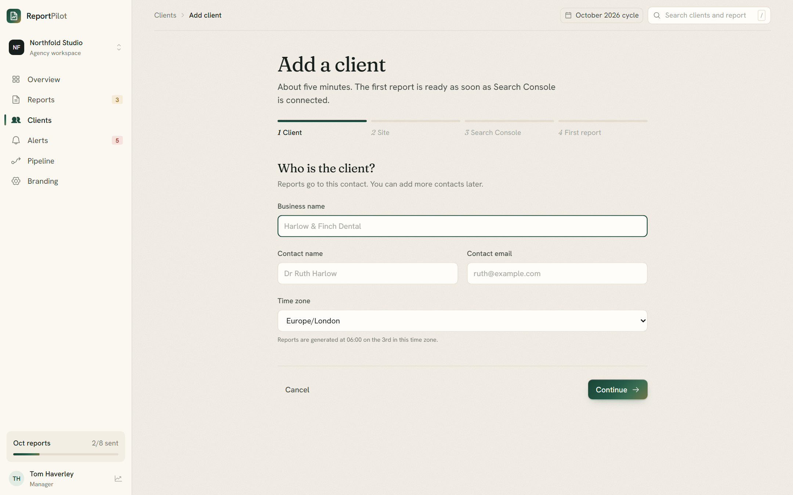

---

### One light theme, designed rather than defaulted

"Paper & Pine": a warm paper ground, deep pine flowing into brass in the
signature gradient, Fraunces for headings and Hanken Grotesk for the
interface. Motion is used where it carries meaning, and every animation stops
when a visitor turns animations off.

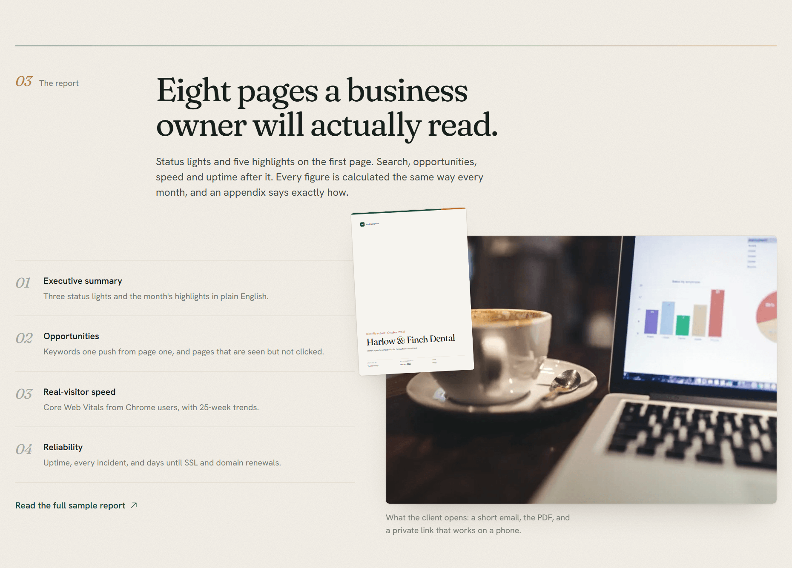

### Built for every screen, tested on twelve

The hero fits on one screen from a 1280 × 720 laptop to a 2560 px ultrawide.
Tables become cards on phones, the report review splits into tabs, and an
automated test fails if any page scrolls sideways or a hero button falls below
the fold.

<table>
<tr>
<td width="50%">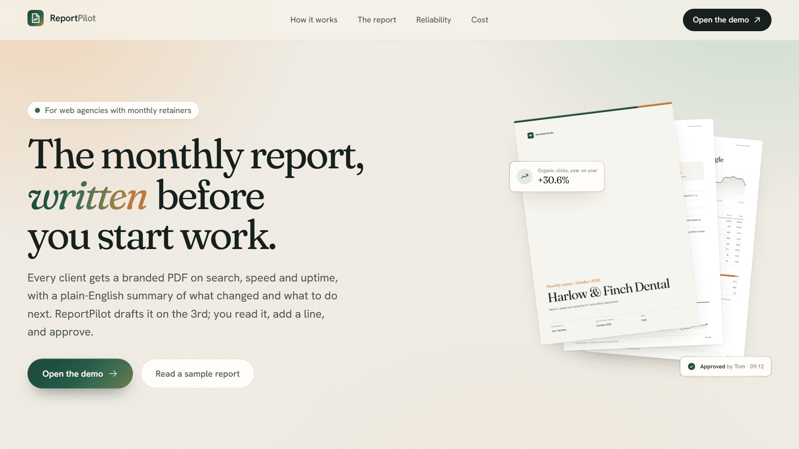</td>
<td width="50%">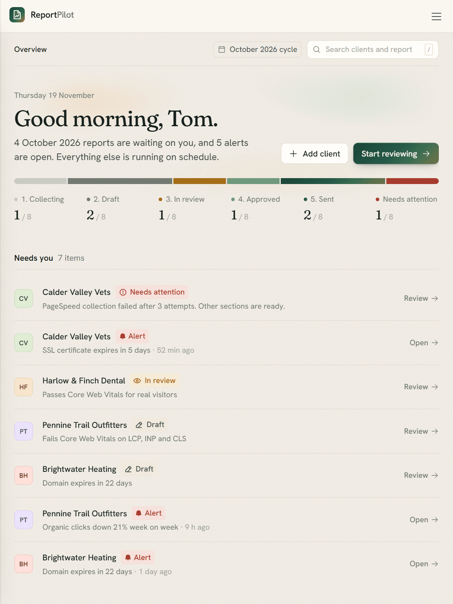</td>
</tr>
<tr>
<td align="center"><b>HD laptop</b>, 1280 × 720</td>
<td align="center"><b>Tablet</b>, 768 × 1024</td>
</tr>
</table>

<table>
<tr>
<td width="33%"></td>
<td width="33%"></td>
<td width="33%"></td>
</tr>
</table>

---

## What you can do

<table>
<tr>
<td width="33%" valign="top">

**Report on search**

Clicks, impressions, CTR and average position with month-on-month and
year-on-year change and 13-month trends, top queries and pages, biggest
movers, devices and branded versus non-branded traffic.

</td>
<td width="33%" valign="top">

**Find the opportunities**

Keywords at positions 8 to 20 with real demand, pages that Google shows often
but people rarely click, with the clicks fixing them is worth, and keywords
that moved on or off page one.

</td>
<td width="33%" valign="top">

**Measure real speed**

Core Web Vitals from real Chrome users with 25-week trends, and Lighthouse lab
scores as the median of three runs, for the homepage and up to five key pages.

</td>
</tr>
<tr>
<td width="33%" valign="top">

**Watch uptime between reports**

Checks every five minutes that require the page's own text, not just a 200; an
incident opens only after two failures 30 seconds apart. A daily job alerts on
expiring SSL and domains, traffic drops, Core Web Vitals regressions and pages
leaving Google's index.

</td>
<td width="33%" valign="top">

**Review, note and approve**

Read the draft as the client will see it, add a personal note, approve, send,
or turn on auto-send per client. Owners, managers and read-only viewers each
see what they may do. Every PDF is versioned and every action logged.

</td>
<td width="33%" valign="top">

**Send it in your brand**

Your logo, colours, name, sender address and footer on every page and email,
and the client's logo on the cover. The client gets the PDF and a private link
that works on a phone, valid for 90 days and revocable at any time.

</td>
</tr>
</table>

---

## How it works

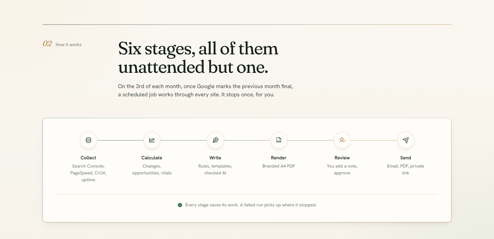

Uptime runs on Cloudflare Workers every five minutes, a daily job raises the
other alerts and finishes any 16-month backfill for new clients, a snapshot
job collects speed, sitemaps and indexing every Monday, and the monthly
pipeline wakes hourly from the 1st to the 8th, processing each client at 06:00
on their own report day in their own time zone. Each report is keyed on site
and month, so re-running never duplicates and never sends twice. The architecture and every
stage are described in the [technical documentation](TECHNICAL_README.md#architecture).

---

## The part that matters

A report is only useful if the client understands it. So the product is built
around the step most reporting tools leave out: **turning figures into
sentences a business owner can act on.**

Every finding is written for the person paying for the work, and carries the
next step. Here is real output for the demo vet practice:

> **SSL certificate expires in 5 days** · Critical · Reliability
>
> The SSL certificate expires in 5 days. If it lapses, browsers will show
> visitors a security warning.
>
> **Next step:** Confirm automatic certificate renewal is working, or renew it
> manually.

> **1 key page not indexed** · Critical · Indexing
>
> 1 key page is not in Google's index. /emergency-vet/ reports "Crawled -
> currently not indexed".
>
> **Next step:** Fix the cause on /emergency-vet/ and request indexing in Search
> Console.

And for the dental practice, a quieter month:

> October 2026 was a steady month for harlowfinch-dental.test. Search, speed
> and reliability are on track.
>
> 10 search terms rank between positions 8 and 20 with 29,822 impressions
> between them. The biggest is "dentist leeds" at position 15.9.

Findings are ranked by severity, and the summary always gives each area a
voice, so a month with good search figures but an hour of downtime is never
described as simply a good month.

### The number check

AI is allowed to make that text read more naturally, and nothing more. Its
rewrite is compared with the source figures: if it rounds 18.3% to "about
18%", invents a figure, or drops most of the numbers, the rewrite is discarded
and the template is used. Only aggregated metrics are ever sent to the model,
never client contact details, and AI can be switched off for any client.

---

## Built with

<div align="center">

<h4>Application</h4>

<table>
<tr>
<td align="center" width="118"><br /><sub><b>Next.js</b><br />15, App Router</sub></td>
<td align="center" width="118"><br /><sub><b>React</b><br />19</sub></td>
<td align="center" width="118"><br /><sub><b>TypeScript</b><br />strict</sub></td>
<td align="center" width="118"><br /><sub><b>Tailwind CSS</b><br />v4 tokens</sub></td>
<td align="center" width="118"><br /><sub><b>Phosphor</b><br />icons</sub></td>
</tr>
</table>

<h4>Data and integrations</h4>

<table>
<tr>
<td align="center" width="118"><br /><sub><b>PostgreSQL</b><br />Neon or Supabase</sub></td>
<td align="center" width="118"><br /><sub><b>Drizzle</b><br />ORM</sub></td>
<td align="center" width="118"><br /><sub><b>Search Console</b><br />service account</sub></td>
<td align="center" width="118"><br /><sub><b>PageSpeed + CrUX</b><br />free API</sub></td>
</tr>
</table>

<h4>Runtimes and delivery</h4>

<table>
<tr>
<td align="center" width="118"><br /><sub><b>Vercel</b><br />dashboard</sub></td>
<td align="center" width="118"><br /><sub><b>Workers</b><br />uptime cron</sub></td>
<td align="center" width="118"><br /><sub><b>GitHub Actions</b><br />monthly job, CI</sub></td>
<td align="center" width="118"><br /><sub><b>R2</b><br />PDF storage</sub></td>
<td align="center" width="118"><br /><sub><b>Resend</b><br />email</sub></td>
</tr>
</table>

<h4>Quality</h4>

<table>
<tr>
<td align="center" width="118"><br /><sub><b>Vitest</b><br />93 tests</sub></td>
<td align="center" width="118"><br /><sub><b>Node.js</b><br />22</sub></td>
<td align="center" width="118"><br /><sub><b>Sentry</b><br />errors</sub></td>
</tr>
</table>

</div>

Also in use, and carrying a good deal of the weight, but without a brand mark
of their own: **Playwright** prints the PDF in a real Chromium and runs the
end-to-end and visual tests; **@sparticuz/chromium** provides Chromium inside
Vercel Functions; **postgres.js** connects to the database; **aws4fetch** signs
R2 uploads; **Healthchecks.io** watches the monthly job; and the charts are
hand-written SVG. Type is set in **Fraunces**, **Hanken Grotesk** and
**Geist Mono**.

The full breakdown, with the role each one plays, is in the
[technical documentation](TECHNICAL_README.md#architecture).

---

## Where it is useful

- **Monthly retainer reporting.** The job it was built for: one report per
  client per month, drafted overnight, approved in minutes.
- **Catching problems early.** Downtime raises an alert within minutes;
  expiring certificates and domains, traffic drops, speed regressions and
  pages leaving Google's index are caught by the next morning's check, not at
  month end.
- **Showing the value of SEO work.** Year-on-year trends, branded versus
  non-branded traffic and the opportunities list make the work visible.
- **White-label agencies.** Every page and email carries the agency's own
  brand; the client never sees ReportPilot.
- **As a reference implementation.** A TypeScript monorepo that spans
  Next.js, a Cloudflare Worker, scheduled GitHub Actions, Google APIs with a
  service account and serverless PDF rendering, with a test at every layer.

ReportPilot reports what Google's APIs and its own checks can measure. It does
not cover paid search, Bing or analytics yet, and Search Console data is two to
three days behind by design.

---

## Project highlights

| | |
| --- | --- |
| **One renderer, two outputs** | The dashboard preview and the client PDF are the same React components, so what is approved is pixel-for-pixel what is sent. |
| **A pipeline that can fail safely** | Each report is keyed on site and month and every stage saves its output, so a crashed run resumes where it stopped and a re-run never emails twice. Both are unit tests. |
| **Honest about missing data** | Each source is collected independently; if PageSpeed hits its quota, the speed page says so and the rest of the report is unaffected. |
| **A number check on AI** | The model may rephrase, never restate: any figure in its text that is not in the data and the template wins. |
| **Service-account access** | Read-only Search Console access without an OAuth consent screen or Google's app verification, revocable by the client at any time. |
| **Serverless PDFs that actually work** | `@sparticuz/chromium` with `playwright-core` pinned to the matching Chromium, its browser files shipped explicitly, and a CI smoke test that prints a PDF through that path on Linux. |
| **Tested against real Postgres** | The dashboard's data layer and the row-level security policies run against PGlite (Postgres in process) with the real migrations, and a browser smoke test drives the whole app in database mode. |
| **Accessible by test** | axe checks every page type against WCAG 2.2 AA in CI, alongside the tagged, outlined PDF. |
| **Responsive by test, not by eye** | Playwright checks the hero is above the fold on seven screen sizes and that no page scrolls sideways at four widths, on desktop and mobile. |

---

## Documentation

Complete engineering detail, from setup and environment variables to
architecture, the pipeline and deployment, lives in one place:

<div align="center">

### [Technical Documentation &rarr;](TECHNICAL_README.md)

</div>

| Looking for | Go to |
| --- | --- |
| Running it locally | [Getting started](TECHNICAL_README.md#getting-started) |
| Every environment variable | [Environment variables](TECHNICAL_README.md#environment-variables) |
| Putting it online | [Deploying to Vercel](docs/vercel-deployment.md) |
| Database, jobs and the uptime worker | [Deployment](docs/deployment.md) |
| Connecting a client's Search Console | [Search Console setup](docs/search-console-setup.md) |
| How the pieces fit together | [Architecture](TECHNICAL_README.md#architecture) |
| What each pipeline stage does | [The monthly pipeline](TECHNICAL_README.md#the-monthly-pipeline) |
| How every figure is calculated | [How figures are calculated](TECHNICAL_README.md#how-figures-are-calculated) |
| Why it is built this way | [Design specification](docs/SPEC.md) · [Architecture decisions](docs/adr/README.md) |
| When something fails | [Runbook](docs/runbook.md) |
| What is stored and for how long | [Privacy](docs/privacy.md) |
| Type, colour and motion | [Design system](docs/design.md) |
| Contributing | [Contributing guide](CONTRIBUTING.md) |

---

## Project status

Ready to deploy to Vercel with no configuration, and runnable on any machine
with Node.js. Continuous integration runs typecheck, lint, 160 unit, contract,
database and pipeline tests, the production build, 79 Playwright end-to-end,
accessibility and PDF visual tests, the serverless PDF smoke test and a secret
scan on every push.

- Complete monthly loop: per-client scheduling, collection with a Search
  Console archive and 16-month backfill, calculation, insights, narrative with
  the number check, versioned PDFs, approval and delivery with bounce tracking
- Sign-in with one-time email links, owner, manager and viewer roles, and a
  dashboard whose every action is saved, validated and audit-logged
- Alerts between reports: downtime from the uptime worker, and SSL, domain,
  traffic, Core Web Vitals, indexing and bounced-email alerts from the daily job
- Error tracking with Sentry in the dashboard, the jobs and the worker, when a
  DSN is set

Known gaps, stated plainly:

- **GA4 is not integrated.** Search Console covers organic Google search only;
  analytics, conversions and traffic sources are the planned next step.
- **No team management screen.** Owners, managers and viewers work, but new
  members are added with the seed script or SQL, not invited from the
  dashboard. Sign-in is by email link only; there is no SSO.
- **Not yet run against a hosted database in CI.** The database code is tested
  on PGlite and smoke-tested through a browser in database mode; a scheduled
  check against a real Neon or Supabase instance is not set up.
- **Live Google, PageSpeed and Resend calls are not exercised by tests.** They
  are covered by contract tests on recorded responses, by design.
- **PDF visual baselines are per machine.** CI renders the pages on Linux and
  creates its baselines on each run, so it catches rendering failures but
  compares pixels only on a machine with approved snapshots.
- **In the demo, uploaded logos are not kept.** Each visitor's changes live in
  a small cookie, which has no room for an image; with a database, logos are
  stored in R2.
- **Uptime runs from one region.** Cloudflare's network is reliable, but this
  is not multi-region monitoring.
- **Accessibility is checked automatically.** axe finds roughly a third of
  issues; a full screen-reader audit has not been done.

---

<div align="center">


**ReportPilot**: the monthly client report, written before you start work

[Technical Documentation](TECHNICAL_README.md)
&nbsp;·&nbsp;
[Deploy to Vercel](docs/vercel-deployment.md)
&nbsp;·&nbsp;
[MIT Licence](LICENSE)

<br />

<sub><i>Photography CC0 via <a href="apps/web/public/images/CREDITS.md">Openverse</a>. The demo agency and its clients are fictional.</i></sub>

<br />

<sub><i>A report is only finished when the client knows what happens next.</i></sub>

</div>
