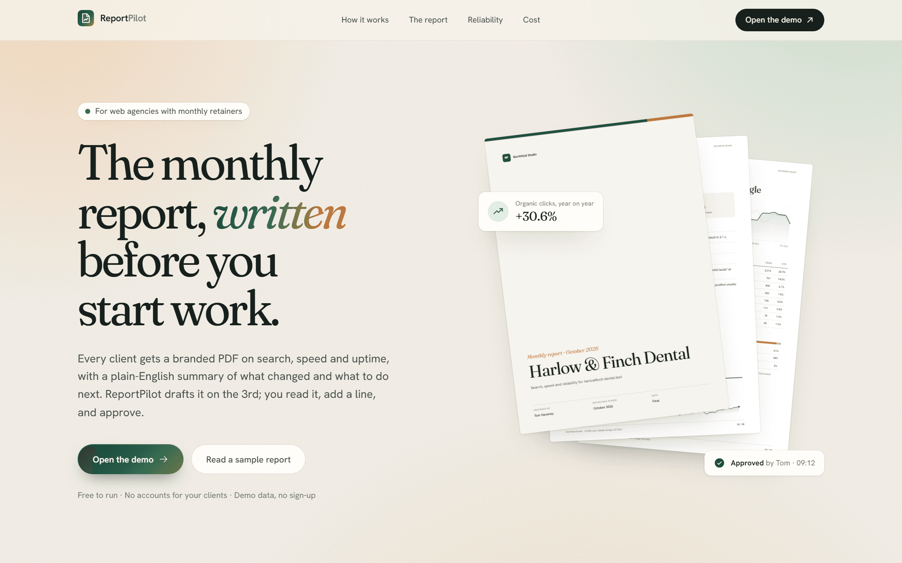
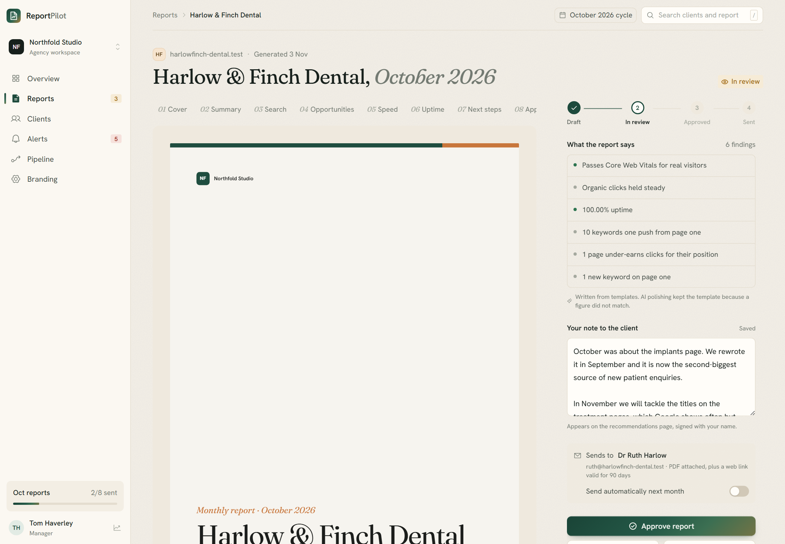
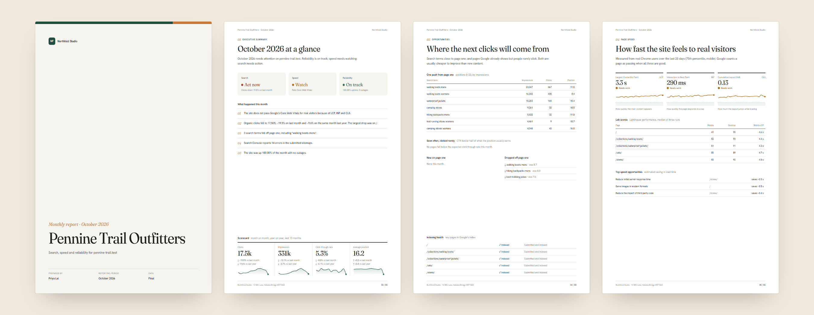
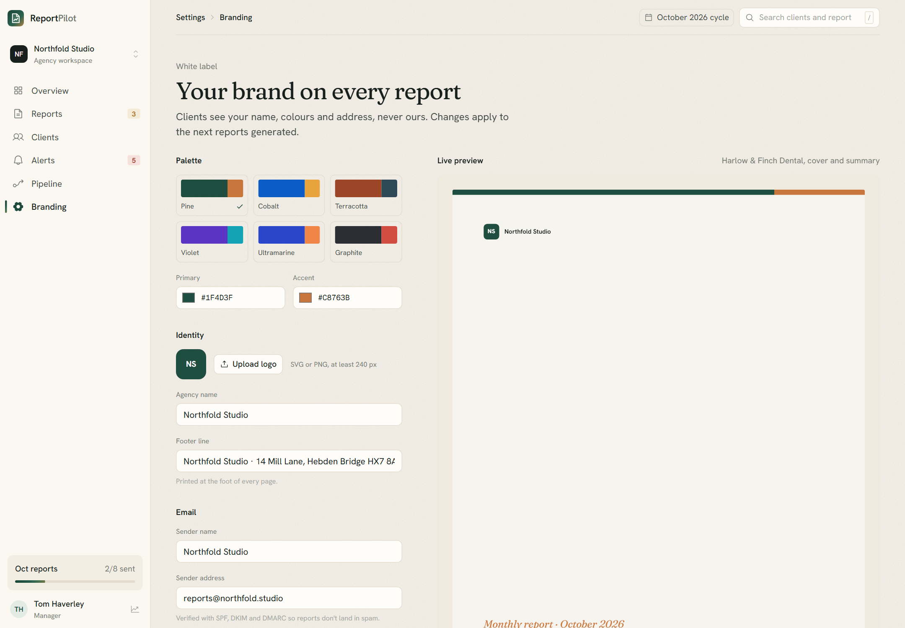
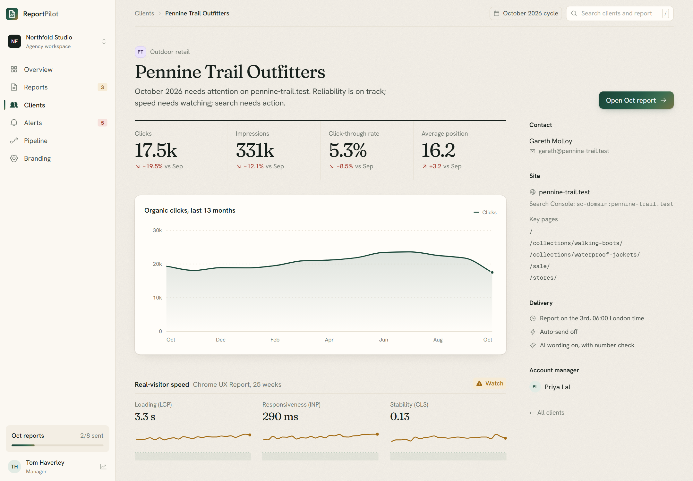
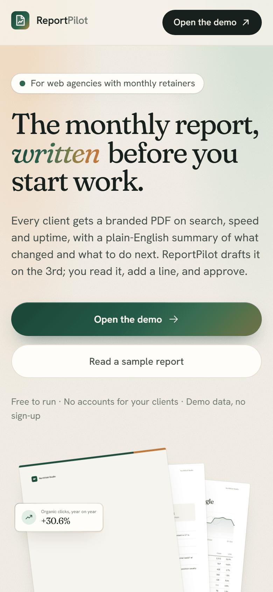
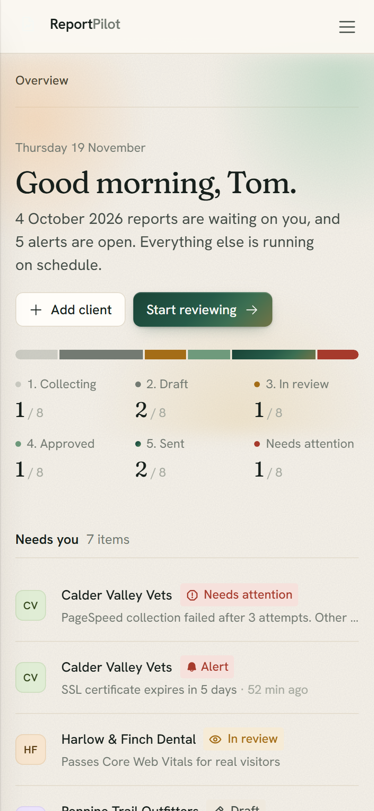
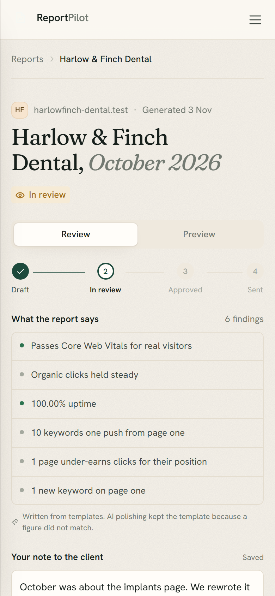

<div align="center">


<h1>ReportPilot</h1>

<h3>The monthly client report, written before you start work.</h3>

<p>
  <b>Every client gets a branded PDF on search, speed and uptime, with a plain-English summary<br />
  of what changed and what to do next. ReportPilot drafts it; you read it, add a line, and approve.</b><br />
  Runs on free tiers. Works without a single API key in demo mode.
</p>

<p>
  <a href="#quickstart"><b>Quickstart&nbsp;&rarr;</b></a>
  &nbsp;&nbsp;·&nbsp;&nbsp;
  <a href="docs/SPEC.md"><b>Design specification</b></a>
  &nbsp;&nbsp;·&nbsp;&nbsp;
  <a href="TECHNICAL_README.md">Technical documentation</a>
  &nbsp;&nbsp;·&nbsp;&nbsp;
  <a href="#inside-the-app">Screenshots</a>
  &nbsp;&nbsp;·&nbsp;&nbsp;
  <a href="#known-gaps">Known gaps</a>
</p>

<p>
  
  
  
  
  
</p>

</div>

<br />



---

## The problem it solves

Web agencies spend **two to four hours per client, every month,** on reporting.
Export Search Console. Run PageSpeed. Check uptime. Paste screenshots into
slides. Write the commentary. Email it. Repeat for the next client. With 20
clients that is 40 to 80 hours a month, and the figures drift depending on who
pulled them.

ReportPilot does that work overnight. On the 3rd of each month, once Google has
finalised the previous month, it collects every client's data, calculates the
changes, writes a plain-English summary, renders an eight-page branded PDF,
and puts the draft in front of the account manager. **Reviewing and approving
takes about ten minutes.** Nothing reaches a client until someone says so.

<table>
  <tr>
    <td width="50%" valign="top">
      <b>Who it is for</b><br /><br />
      Agencies and freelancers on monthly SEO or website-care retainers who
      want to stop rebuilding the same report by hand, and want the report to
      be <i>better</i> than the one they would have written.
    </td>
    <td width="50%" valign="top">
      <b>What the client gets</b><br /><br />
      A short email, the PDF attached, and a private link that works on a
      phone. No account, no login, nothing to learn. Just what changed, why it
      matters and what happens next.
    </td>
  </tr>
</table>

### What makes it different

| | |
| --- | --- |
| **Approval first** | Draft → In review → Approved → Sent. Every change is versioned and audit-logged. Auto-send is a per-client choice, not a default. |
| **Honest numbers** | Every figure comes from one tested calculation library. If PageSpeed fails, the speed page says "unavailable this month"; it never shows zeros. |
| **AI that can't misquote** | AI may polish the summary, but if its text contains any number that isn't in the source data, it is thrown away and the template is used. |
| **Opportunities, not just charts** | Keywords one push from page one, pages that are seen but not clicked, and how many clicks fixing them is worth. |
| **Alerts between reports** | Uptime every five minutes with a two-failure rule, SSL and domain expiry, traffic drops and Core Web Vitals regressions. |
| **Your brand, never ours** | Colours, logo, sender and footer per agency. The PDF re-themes live in the branding studio. |
| **£0 to run** | Cloudflare Workers for uptime, GitHub Actions for the monthly job, Postgres on a free tier. About 50 sites before anything costs money. |

---

## Inside the app


<p align="center"><sub><b>Overview.</b> Where the month's reports are, what is waiting on you, and the time it saved.</sub></p>

<br />


<p align="center"><sub><b>Report review.</b> The real PDF on the left, scaled. Findings, your note and the approve button on the right.</sub></p>

<br />


<p align="center"><sub><b>The client PDF.</b> Eight A4 pages, printed by a real Chromium from the same components as the preview.</sub></p>

<br />

<table>
  <tr>
    <td width="50%"></td>
    <td width="50%"></td>
  </tr>
  <tr>
    <td align="center"><sub><b>Branding studio.</b> Pick a palette and watch the report re-theme.</sub></td>
    <td align="center"><sub><b>Client.</b> Thirteen months of search, speed and uptime at a glance.</sub></td>
  </tr>
  <tr>
    <td width="50%"></td>
    <td width="50%"></td>
  </tr>
  <tr>
    <td align="center"><sub><b>Pipeline.</b> Every stage of every run, and exactly what failed.</sub></td>
    <td align="center"><sub><b>Alerts.</b> Problems caught when they happen, not at month end.</sub></td>
  </tr>
</table>

<br />

<table>
  <tr>
    <td width="33%"></td>
    <td width="33%"></td>
    <td width="33%"></td>
  </tr>
</table>
<p align="center"><sub><b>On a phone.</b> Drawer navigation, cards instead of tables, and the review split into tabs. Tested at 360, 390, 768 and 1024 px for horizontal overflow.</sub></p>

---

## Quickstart

**Requirements:** Node.js 22+. No database, accounts or API keys for the demo.

```bash
git clone https://github.com/zain-ul-abideen-5036/ReportPilot.git
cd ReportPilot
npm install
npx playwright install chromium

npm run dev        # the dashboard and landing page on http://localhost:3000 (Turbopack)
npm run demo       # run the real monthly pipeline end to end: 8 PDFs in output/

npm run build && npm start   # production build: what visitors actually get
```

The demo is a fictional agency, Northfold Studio, with eight clients. Each one
has a story: a dental practice growing steadily, an outdoor shop hit by an
algorithm update, a vet with an SSL certificate about to expire, a heating
engineer whose new chat widget slowed the site down.

To connect real data, see [deployment](docs/deployment.md) and
[connecting Search Console](docs/search-console-setup.md).

---

## How it works

```mermaid
flowchart LR
    subgraph Every five minutes
      W[Uptime Worker<br/>Cloudflare cron] -->|checks, incidents| DB
    end
    subgraph Every Monday
      S[Snapshot job<br/>PageSpeed median of 3 · CrUX · URL Inspection · expiry] --> DB
    end
    subgraph 2nd–4th of each month
      P[Pipeline<br/>GitHub Actions] --> C1[Collect] --> C2[Calculate] --> C3[Insights] --> C4[Narrative] --> C5[Render PDF]
    end
    DB[(Postgres)] <--> P
    C5 --> R{Review in dashboard}
    R -->|approved| E[Email + PDF + private link]
```

Every stage writes its result to the database, so a failed run resumes where
it stopped, and a report is keyed on site and month, so re-running never sends
twice. The [specification](docs/SPEC.md) and the
[architecture decisions](docs/adr/README.md) explain the reasoning.

---

## Built with

| | |
| --- | --- |
| **Dashboard** | Next.js 15, React 19, Tailwind CSS v4, Phosphor icons, Fraunces and Hanken Grotesk |
| **Report** | React components with print geometry, hand-written SVG charts, Playwright `page.pdf()` |
| **Data** | Postgres with Drizzle ORM; Search Console, PageSpeed Insights, CrUX History, RDAP |
| **Runtimes** | Cloudflare Workers (uptime), GitHub Actions (jobs), any Node host (dashboard) |
| **Delivery** | Resend email, Cloudflare R2 storage, Healthchecks.io heartbeat |
| **Quality** | Vitest (93 tests), Playwright end-to-end and PDF visual regression, gitleaks, Dependabot |

```
apps/web               dashboard and landing page
packages/core          calculations, insights, narrative and the number check
packages/report        the A4 report, shared by preview and PDF
packages/charts        SVG charts
packages/integrations  Google APIs, RDAP, TLS
packages/db            schema, migrations, seed
packages/demo          the sample agency
workers/uptime         Cloudflare Worker
jobs/pipeline          monthly and weekly jobs
```

---

## Documentation

| Document | For |
| --- | --- |
| [Design specification](docs/SPEC.md) | The full design: problem, scope, architecture, data model, pipeline, security |
| [Technical documentation](TECHNICAL_README.md) | How the code fits together, and how to work on it |
| [Architecture decisions](docs/adr/README.md) | Why it is built this way, and what each choice costs |
| [Deployment](docs/deployment.md) | Going live on free tiers |
| [Search Console setup](docs/search-console-setup.md) | Connecting clients with a service account |
| [Runbook](docs/runbook.md) | What to do when something fails |
| [Privacy](docs/privacy.md) | What is stored, for how long, and who can see it |
| [Design system](docs/design.md) | Type, colour, motion and layout |

---

## Known gaps

This is an MVP, and the README says so.

- **Dashboard actions are not persisted yet.** Approve, notes, alert
  acknowledgement and branding work in the interface but update local state in
  demo mode; the database layer and pipeline already support them, the server
  actions connecting the two are next.
- **No authentication provider is wired up.** The schema has users, roles and
  memberships, and optional row-level security policies, but sign-in is not
  implemented.
- **GA4 is not integrated.** Search Console covers organic Google search only.
- **Uptime runs from one region.**
- **Bounce handling** is designed (contacts are flagged) but the Resend
  webhook endpoint is not built.

---

## Credits

Photography on the landing page is CC0 from StockSnap via
[Openverse](https://openverse.org); see
[credits](apps/web/public/images/CREDITS.md). The demo agency and its clients
are fictional.

## Licence

[MIT](LICENSE) © Zain Ul Abideen
