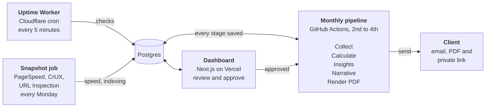

# ReportPilot: Technical Documentation

Everything needed to run, configure, deploy and extend ReportPilot. For what
the product does and screenshots, see the [README](README.md); for the
reasoning behind the design, the [specification](docs/SPEC.md).

## Contents

- [Getting started](#getting-started)
- [Environment variables](#environment-variables)
- [Deploying to Vercel](#deploying-to-vercel)
- [Architecture](#architecture)
- [The monthly pipeline](#the-monthly-pipeline)
- [How figures are calculated](#how-figures-are-calculated)
- [The number check](#the-number-check)
- [Security and privacy](#security-and-privacy)
- [Testing](#testing)
- [Project structure](#project-structure)
- [Extending it](#extending-it)
- [Troubleshooting](#troubleshooting)
- [Limitations](#limitations)

---

## Getting started

**Requirements:** Node.js 22 or newer. No database, no accounts, no API keys.

```bash
git clone https://github.com/zain-ul-abideen-5036/ReportPilot.git
cd ReportPilot
npm install
npx playwright install chromium   # for PDFs and end-to-end tests

npm run dev                        # http://localhost:3000
```

The dashboard opens on a fictional agency, Northfold Studio, with eight
clients and a full October cycle: reports in every state, alerts, pipeline
runs and history.

### Useful local modes

| Command | What it does |
| --- | --- |
| `npm run dev` | Dashboard with Turbopack. The first page compiles in about 10 seconds, later pages in under one |
| `npm run build && npm start` | The production build. Dev mode compiles each page on first visit, so judge speed here |
| `npm run demo` | Runs the real monthly pipeline on the demo agency: 8 PDFs in `output/reports/`, email previews in `output/emails/` |
| `npm test` | 93 unit, contract, worker and pipeline tests |
| `npm run typecheck` | `tsc` in every workspace |
| `npm run test:e2e` | Playwright on desktop and mobile against a production build |
| `npx tsx jobs/pipeline/src/cli.ts monthly --period 2026-10 --dry-run` | A real run against `DATABASE_URL`, sending nothing |
| `NEXT_DIST_DIR=.next-prod npm run build` | Build beside a running dev server without the two overwriting each other |
| `node scripts/screenshot.mjs http://localhost:3100` | Regenerate and compress the README screenshots |

---

## Environment variables

Nothing is required for the demo. All variables are listed in
[`.env.example`](.env.example).

| Variable | Used by | Purpose |
| --- | --- | --- |
| `DATABASE_URL` | dashboard, jobs, worker | Postgres connection (pooled). Without it the dashboard uses the demo agency |
| `GOOGLE_SERVICE_ACCOUNT_JSON` | jobs | Service account for Search Console, on one line ([setup](docs/search-console-setup.md)) |
| `PAGESPEED_API_KEY` | weekly job | PageSpeed Insights and CrUX History (free) |
| `GEMINI_API_KEY` | monthly job | Optional AI wording, behind the [number check](#the-number-check) |
| `RESEND_API_KEY` | monthly job, worker | Report and alert emails |
| `R2_ACCOUNT_ID`, `R2_BUCKET`, `R2_ACCESS_KEY_ID`, `R2_SECRET_ACCESS_KEY` | monthly job | PDF storage on Cloudflare R2 |
| `HEALTHCHECK_MONTHLY_URL` | monthly job | Heartbeat ping at start and finish |
| `APP_URL` | dashboard, jobs | Public URL used in client report links |
| `VERCEL_AUTOMATION_BYPASS_SECRET` | dashboard on Vercel | Lets PDFs print on protected preview deployments |
| `NEXT_DIST_DIR` | dashboard build | Optional build directory (default `.next`) |

Production secrets live in GitHub Actions secrets, Vercel environment
variables and `wrangler secret`, never in the repository; gitleaks scans every
push.

---

## Deploying to Vercel

The dashboard and landing page deploy to Vercel with **no code changes and no
environment variables**. The full step-by-step walkthrough, with every
setting and a troubleshooting table, is in
**[docs/vercel-deployment.md](docs/vercel-deployment.md)**.

| | Your computer | Vercel |
| --- | --- | --- |
| Data | Demo agency, or Postgres | Same |
| PDF browser | Playwright's Chromium | `@sparticuz/chromium` 153, with `playwright-core` pinned to the matching 1.63.0 |
| PDF time limit | none | 60 seconds; a cold start takes 3 to 6 |
| Jobs and uptime | run locally on demand | GitHub Actions and Cloudflare Workers, not Vercel |

### Steps

1. **Import the repository.** At [vercel.com](https://vercel.com) choose **Add New → Project** and import ReportPilot.
2. **Set Root Directory to `apps/web`.** Vercel detects Next.js. `apps/web/vercel.json` already sets the install command (from the repository root, for npm workspaces) and the build command.
3. **Deploy.** No variables are needed for the demo. Add `APP_URL` and, for real data, `DATABASE_URL` later under **Settings → Environment Variables**, then redeploy.

Every push to `main` then deploys to production, and every pull request gets a
preview URL.

### How it works on Vercel

- [`packages/report/src/pdf.ts`](packages/report/src/pdf.ts) detects Vercel (`VERCEL` or `AWS_LAMBDA_FUNCTION_NAME`) and launches `@sparticuz/chromium` through `playwright-core-serverless`, an npm alias for `playwright-core@1.63.0`, the release built for Chromium 153. Locally it uses the full `playwright` package.
- It filters `@sparticuz/chromium`'s `--single-process` flag, which lets closing one page take the whole browser down, and `--headless`, which Playwright sets itself.
- `outputFileTracingRoot` in [`next.config.ts`](apps/web/next.config.ts) traces dependencies from the monorepo root, and `outputFileTracingIncludes` ships `@sparticuz/chromium`'s compressed browser with the PDF function, because it is read from disk at run time and file tracing cannot see it.
- One browser is shared per function instance and each report's PDF is kept in memory, so only the first download after a cold start pays the launch cost.
- On protected preview deployments the PDF route sends `VERCEL_AUTOMATION_BYPASS_SECRET` as `x-vercel-protection-bypass`, so printing its own page does not hit the login screen.
- CI runs [`scripts/serverless-pdf-smoke.ts`](scripts/serverless-pdf-smoke.ts) on Linux with `VERCEL=1`, which prints a real PDF through this exact path on every push.

Vercel's Hobby plan is for personal, non-commercial use. Client work should run
on a Pro account or on Cloudflare.

---

## Architecture



An npm workspaces monorepo. Every package ships TypeScript source; Next.js and
`tsx` compile it, so there is no build step between packages.

| Workspace | Depends on | Purpose |
| --- | --- | --- |
| `packages/core` | nothing | Pure functions: changes, search opportunities, vitals, uptime, the rules engine, narrative, number check |
| `packages/demo` | core | A seeded, deterministic sample agency shaped exactly like the collectors' output |
| `packages/charts` | react | Server-rendered SVG charts that read colours from CSS variables |
| `packages/report` | core, charts | The A4 report as React components; HTML and PDF rendering |
| `packages/integrations` | core | Search Console, PageSpeed, CrUX, RDAP and TLS over plain `fetch` |
| `packages/db` | core, demo | Drizzle schema, generated migration, seed, retention |
| `apps/web` | core, demo, charts, report | Dashboard, landing page, print route and PDF download |
| `workers/uptime` | core | Cloudflare Worker: checks, incidents, alerts, nightly rollup |
| `jobs/pipeline` | everything | Monthly and weekly jobs and their command line |

### Data flow

```
collectors ──► CollectedData ──► buildReport() ──► ReportData ──► templateNarrative() ──► Narrative
 (integrations,                   core/report.ts                   core/narrative.ts
  pg-store, demo)                                                        │
                                                                         ▼
                                                    ReportDocument (packages/report) ──► PDF
```

- **`CollectedData`** ([`core/types.ts`](packages/core/src/types.ts)) is everything one site needs for one month. Each source may be `null`, and nothing downstream assumes it isn't.
- **`buildReport`** is pure and deterministic: KPIs with month-on-month and year-on-year changes, opportunities, movers, vitals ratings, an uptime summary, status lights and ranked findings.
- **Findings** ([`core/insights.ts`](packages/core/src/insights.ts)) carry the formatted figures their sentences quote, which is what makes the number check possible.
- **`ReportDocument`** renders identically in the dashboard (scaled with a CSS transform) and in Chromium for the PDF.

---

## The monthly pipeline

[`jobs/pipeline/src/runner.ts`](jobs/pipeline/src/runner.ts). For each active
site, `runSite(site, period, deps)`:

| Stage | What happens | Reliability |
| --- | --- | --- |
| Plan | Upsert the report on `(site_id, period)` | A unique index: re-running never duplicates |
| Collect | Search Console (this month, last month, last year, 13-month trend), speed snapshot, uptime, indexing | Sources are independent; a failure is recorded and the section says "unavailable" |
| Calculate and insights | `buildReport` | Pure, unit-tested |
| Narrative | Template text, optionally rewritten by AI | The number check decides |
| Render | PDF stored under `reports/<org>/<site>/<period>/v<n>.pdf` | Versioned keys; a sent file is never overwritten |
| Review | Auto-send clients are approved and audit-logged; others wait at `draft` | Nothing reaches a client without approval |
| Deliver | Email with PDF, private link and plain-text alternative | Sent once; dry runs write the email to `output/` |

Every stage runs inside `withRetry` (three attempts, exponential backoff),
writes a `job_runs` row per attempt and saves its output before the next
starts, so a failed run resumes at the stage that failed. A site whose month
Search Console has not finalised waits and is retried on the next scheduled
day. Healthchecks.io is pinged at start and finish.

---

## How figures are calculated

All in [`packages/core`](packages/core/src), each with unit tests.

| Figure | Definition |
| --- | --- |
| Change | `(current - previous) / previous`; no value when the previous month is 0 or missing. 1,000 → 1,200 is +20.0% |
| Trend | Changes under 2% are flat. Average position is better when it falls |
| Striking distance | Queries at positions 8 to 20 with at least 100 impressions, largest audience first |
| Low CTR | Pages with at least 500 impressions in the top 20 whose CTR is under half the typical CTR for their position; missed clicks = impressions × expected CTR − clicks |
| Movers | Click change per page and query between months; a page missing in one month counts as 0 |
| Top-10 movement | Queries crossing position 10 in either direction |
| Branded split | Queries matching the client's brand pattern (case-insensitive) vs the rest |
| Core Web Vitals | Google's thresholds: LCP ≤ 2.5 s, INP ≤ 200 ms, CLS ≤ 0.1 are good; passing means all three good |
| Lab score | Median of three Lighthouse runs per page and device |
| Uptime | Successful checks over all checks, averaged across days; an incident opens only after two failures 30 seconds apart |
| Status lights | Search: act at −15% clicks, watch below −5%. Speed: act if any vital is poor. Reliability: act under 99% uptime or under 7 days of SSL |

---

## The number check

[`core/number-check.ts`](packages/core/src/number-check.ts). AI is only ever
asked to *rewrite* the template summary. Its text is accepted only if every
number in it appears in the source (after normalising commas, signs and
trailing zeros), it keeps at least half of the source's figures, and it is not
trivially short. Otherwise the template is used. Only aggregated metrics are
sent, never contact details, and AI can be turned off per client. See
[ADR 0004](docs/adr/0004-number-check.md).

---

## Security and privacy

- **Google access** is read-only: a service account added as a Restricted user, revocable by the client at any time.
- **Report links** use random 128-bit tokens, expire after 90 days, can be revoked, and are served with `X-Robots-Tag: noindex` and `no-referrer`.
- **Every query** is scoped by organisation; optional row-level security policies are in [`packages/db/sql`](packages/db/sql/row-level-security.sql).
- **Headers:** `X-Frame-Options: DENY`, `X-Content-Type-Options: nosniff` and a restrictive `Permissions-Policy` on every page.
- **Retention:** raw uptime checks are deleted after 90 days; client contact emails are the only personal data ([privacy](docs/privacy.md)).

---

## Testing

| Layer | Where | What it proves |
| --- | --- | --- |
| Unit | `packages/core/test` | Every calculation has a known answer; reports are deterministic; the number check rejects invented figures |
| Contract | `packages/integrations/test` | Pagination, retries, auth and parsing against recorded responses, never live Google |
| Worker | `workers/uptime/test` | The two-failure rule, keyword checks, recovery and the nightly rollup |
| Pipeline | `jobs/pipeline/test` | Idempotency, resume after failure, partial data, the approval gate, dry runs, AI fallback |
| End to end | `e2e/` | Review flow, onboarding, alerts, `noindex` links, reduced motion, hero above the fold on seven screen sizes, no horizontal scroll at four widths |
| Visual | `e2e/pdf.spec.ts` | Each PDF page against an approved snapshot |
| Serverless | `scripts/serverless-pdf-smoke.ts` | The Vercel PDF path prints a real PDF on Linux |

CI runs all of them, plus a gitleaks secret scan, on every push.

---

## Project structure

```
apps/web
  src/app                 routes: landing, (app) dashboard pages, print, r/[token], api
  src/components          shell, ui, dashboard, review, landing, alerts, onboarding, settings
  src/lib/data.ts         data access (demo agency, computed once per process)
  vercel.json             Vercel install and build commands
packages/core             calculations, insights, narrative, number check
packages/report           the A4 report, HTML and PDF rendering
packages/charts           SVG charts
packages/integrations     Google APIs, RDAP, TLS
packages/db               Drizzle schema, migrations, seed, row-level security
packages/demo             the sample agency
workers/uptime            Cloudflare Worker
jobs/pipeline             monthly and weekly jobs, CLI
e2e                       Playwright tests
docs                      specification, ADRs, guides, screenshots
scripts                   screenshots, serverless smoke test
```

---

## Extending it

### Add an insight rule

1. Add the rule to [`core/insights.ts`](packages/core/src/insights.ts), returning a `Finding` whose `facts` hold every figure its sentence uses.
2. Give it an `action` if it should appear in next month's recommendations.
3. Add a unit test with a known answer.

### Change the design

Tokens are in [`apps/web/src/app/globals.css`](apps/web/src/app/globals.css):
colour, type scale, radii, one easing curve, three durations and the signature
gradients. Components never use raw values. The PDF's look is in
[`packages/report/src/styles.ts`](packages/report/src/styles.ts). See the
[design system](docs/design.md).

### Upgrading Chromium on Vercel

`@sparticuz/chromium` and `playwright-core-serverless` must target the same
Chromium version:

1. Find the newest `@sparticuz/chromium` release; its major version is the Chromium major, for example 153.
2. Find the `playwright-core` release built for that Chromium in Playwright's release notes.
3. Update both in [`packages/report/package.json`](packages/report/package.json), for example `"@sparticuz/chromium": "153.0.0"` and `"playwright-core-serverless": "npm:playwright-core@1.63.0"`.
4. Push. The serverless smoke test in CI fails if they do not match.

---

## Troubleshooting

| Problem | Fix |
| --- | --- |
| A page takes 10 seconds or more the first time in dev | Normal for dev mode, which compiles on first visit. Use `npm run build && npm start` to judge speed |
| `next build` fails with *no direct app page entry found for /_not-found* | A dev server is writing to the same `.next` folder. Stop it, or build with `NEXT_DIST_DIR=.next-prod` |
| The PDF button returns 503 locally | Run `npx playwright install chromium` |
| The PDF button returns 503 on Vercel | See [Vercel troubleshooting](docs/vercel-deployment.md#troubleshooting) |
| Demo run fails with *React is not defined* | Run it from the repository root, where `tsconfig.json` sets the JSX runtime |
| `Search Console: 403` | The service account is not a user on that property ([guide](docs/search-console-setup.md)) |

More operational cases are in the [runbook](docs/runbook.md).

---

## Limitations

- Dashboard actions (approve, notes, alert acknowledgement, branding) update local state in demo mode; the server actions that persist them are not written yet.
- No authentication provider is wired up; the schema has users, roles and row-level security ready for one.
- Search Console covers organic Google search only. GA4 is planned.
- Uptime is checked from one region.
- Bounce handling is designed but the Resend webhook endpoint is not built.
